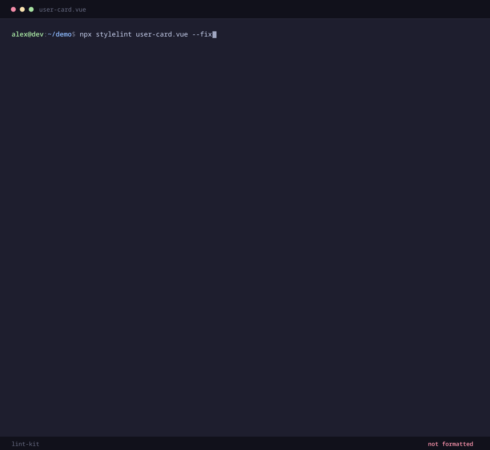

# Lint Kit

[](https://www.npmjs.com/package/@alexlit/lint-kit)
[](https://npmx.dev/package/@alexlit/lint-kit)
[](LICENSE)

Набор пакетов с конфигурациями для линтинга и форматирования кода Vue +
TypeScript проектов.

## До и после



До:

<!-- prettier-ignore -->
```vue
<script setup lang="ts">
import { computed } from "vue";
interface UserCardProps{
  title:string;count?:number;items:string[];
}
const {title,count=0,items}=defineProps<UserCardProps>();
const label=computed(()=>`${title} (${count})`);
const first=computed(()=>items.find((item)=>item.length>3));
</script>

<template>
  <article class="user-card p-4 bg-white flex flex-col gap-2 rounded-lg shadow
    hover:shadow-lg dark:bg-gray-900 sm:flex-row sm:items-center">
    <h2 class="text-lg font-semibold">{{ label }}</h2>
    <p class="text-sm text-gray-500">{{ first }}</p>
    <ul class="flex gap-2">
      <li v-for="item in items" :key="item" class="px-2 py-2 text-xs bg-gray-100 rounded">{{ item }}</li>
    </ul>
  </article>
</template>

<style lang="postcss" scoped>
@custom-media --tablet (width >= 768px);

.user-card {
  display: flex;
  width: 100%;
  padding: 16px;
  color: #FF0000;

  &:hover { color: #00FF00; }

  @media (--tablet) {
    padding: 24px;
  }
}

.user-card__title {
  font-weight: 700;
  @apply text-gray-900 text-lg;
}
</style>
```

После `stylelint --fix`, `prettier --write` и `eslint --fix`:

<!-- prettier-ignore -->
```vue
<script setup lang="ts">
  import { computed } from 'vue';

  interface UserCardProps {
    count?: number;
    items: string[];
    title: string;
  }

  const { count = 0, items, title } = defineProps<UserCardProps>();
  const label = computed(() => `${title} (${count})`);
  const first = computed(() => items.find((item) => item.length > 3));
</script>

<template>
  <article
    :class="`
      user-card flex flex-col gap-2 rounded-lg bg-white p-4 shadow-sm
      hover:shadow-lg
      sm:flex-row sm:items-center
      dark:bg-gray-900
    `"
  >
    <h2 class="text-lg font-semibold">{{ label }}</h2>

    <p class="text-sm text-gray-500">{{ first }}</p>

    <ul class="flex gap-2">
      <li
        v-for="item in items"
        :key="item"
        class="rounded-sm bg-gray-100 p-2 text-xs"
      >
        {{ item }}
      </li>
    </ul>
  </article>
</template>

<style lang="postcss" scoped>
  @custom-media --tablet (width >= 768px);

  .user-card {
    color: rgb(255 0 0);
    display: flex;
    inline-size: 100%;
    padding: 16px;

    @media (--tablet) {
      padding: 24px;
    }

    &:hover,
    &:focus {
      color: rgb(0 255 0);
    }
  }

  .user-card__title {
    @apply text-lg text-gray-900;

    font-weight: 700;
  }
</style>
```

## Пакеты

| Пакет                                                  | Назначение                         |
| :----------------------------------------------------- | :--------------------------------- |
| [eslint](packages/config-eslint/README.md)             | Линтинг JavaScript и TypeScript    |
| [hooks](packages/config-hooks/README.md)               | Git-хуки (commitlint, lint-staged) |
| [htmllint](packages/config-htmllint/README.md)         | Линтинг HTML                       |
| [markdownlint](packages/config-markdownlint/README.md) | Линтинг Markdown                   |
| [npmlint](packages/config-npmlint/README.md)           | Линтинг `package.json`             |
| [prettier](packages/config-prettier/README.md)         | Форматирование кода                |
| [stylelint](packages/config-stylelint/README.md)       | Линтинг CSS                        |

## Установка

Рекомендуется устанавливать необходимые пакеты по отдельности - так вы
подключаете только те линтеры, которые необходимы и сможете управлять их
версиями.

Инструкции по настройке каждого пакета приведены в его README (см. ссылки в
разделе [«Пакеты»](#пакеты)).

```bash
# установка необходимого пакета
npm install --save-dev @alexlit/config-<PACKAGE_NAME>

# или все сразу одной командой
npm install --save-dev @alexlit/lint-kit
```
