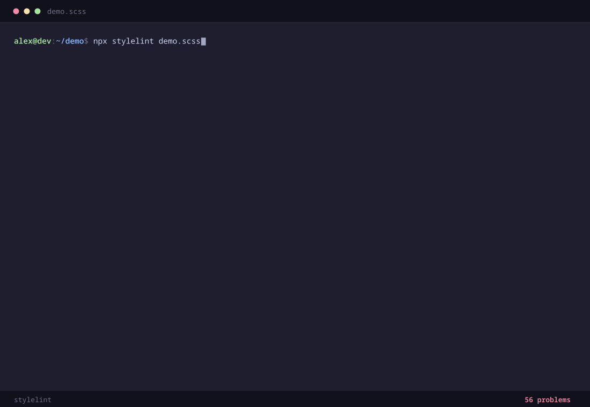

# Stylelint Configuration

[](https://www.npmjs.com/package/@alexlit/config-stylelint)
[](https://npmx.dev/package/@alexlit/config-stylelint)
[](LICENSE)

Готовая конфигурация [Stylelint](https://stylelint.io/) для проверки CSS, SCSS и
Vue-файлов: настроенные правила из популярных stylelint-плагинов - порядок и
синтаксис свойств, доступность, БЭМ, поддержка SCSS и т.д. Вместо того чтобы
подключать и настраивать каждый плагин вручную, соберите конфигурацию из готовых
проверок.

Проверки модульные: по умолчанию ничего не включено - вы сами перечисляете
нужные в `defineConfig`.

## Содержание

- [Установка](#установка)
- [Быстрый старт](#быстрый-старт)
- [До и после](#до-и-после)
- [Пример скриптов для package.json](#пример-скриптов-для-packagejson)
- [Настройка](#настройка)
  - [Правила конкретной проверки](#правила-конкретной-проверки)
  - [Правила для отдельных файлов](#правила-для-отдельных-файлов)
  - [Приоритет настроек](#приоритет-настроек)
  - [Общие настройки Stylelint](#общие-настройки-stylelint)
- [Проверки](#проверки)
- [Миграция с v65](#миграция-с-v65)
- [Миграция с v63](#миграция-с-v63)
- [Миграция с v61](#миграция-с-v61)
- [Разработка](#разработка)
- [Полезные ссылки](#полезные-ссылки)

## Установка

```bash
npm i @alexlit/config-stylelint -D
```

## Быстрый старт

```js
// stylelint.config.js
import { defineConfig, plugins } from '@alexlit/config-stylelint';

export default defineConfig({
  plugins: [plugins.scss(), plugins.vue(), plugins.prettier()],
});
```

## До и после



До:

```text
@custom-media   --mobile   (width < 600px);
@custom-media --reduce-motion (prefers-reduced-motion:reduce);

.card{ padding:var(--card-gap);
    --color-brand:#FF0000;

    @media (--mobile){padding:calc(var(--card-gap)/2);}
  --card-gap:16px; display:block;
  &__title{text-transform:uppercase;font-weight:bold;}
      --card-bg:#FFFFFF;


       border-radius:var(--card-radius);
        --card-radius:12px;
  color:var(--color-brand);
  --color-brand-hover:#00FF00;
      background-color:var(--card-bg);
  transition:color .2s;
      &--wide{padding:calc(var(--card-gap)*2);}
  &:hover{color:var(--color-brand-hover);}
  @media (--reduce-motion){transition:none;}
}
```

После `stylelint --fix`:

```scss
@custom-media --mobile (width < 600px);
@custom-media --reduce-motion (prefers-reduced-motion: reduce);

.card {
  --card-bg: rgb(255 255 255);
  --card-gap: 16px;
  --card-radius: 12px;
  --color-brand: rgb(255 0 0);
  --color-brand-hover: rgb(0 255 0);

  background-color: var(--card-bg);
  border-radius: var(--card-radius);
  color: var(--color-brand);
  display: block;
  padding: var(--card-gap);
  transition: color 0.2s;

  @media (--mobile) {
    padding: calc(var(--card-gap) / 2);
  }

  @media (--reduce-motion) {
    transition: none;
  }

  &:hover,
  &:focus {
    color: var(--color-brand-hover);
  }

  &--wide {
    padding: calc(var(--card-gap) * 2);
  }

  &__title {
    font-weight: bold;
    text-transform: uppercase;
  }
}
```

`--fix` сортирует CSS-переменные и свойства, приводит цвета к `rgb`, дополняет
`:hover` до `:hover, :focus` и переносит вложенные медиазапросы наверх. Проверки
БЭМ, логических свойств и кастомных медиа-запросов требуют ручной правки.

## Пример скриптов для package.json

```json
{
  "scripts": {
    "lint:css": "stylelint '**/*.{css,scss,sass,pcss,vue}' --fix --ignore-path .gitignore"
  }
}
```

Каждый вызов `plugins.*()` - отдельная проверка. Добавьте только то, что нужно
проекту; полный список - в разделе [Проверки](#проверки).

Больше проверок - просто допишите их в массив:

```js
// stylelint.config.js
import { defineConfig, plugins } from '@alexlit/config-stylelint';

export default defineConfig({
  plugins: [
    plugins.a11y(),
    plugins.bem(),
    plugins.colorFormat(),
    plugins.declarationBlockNoIgnoredProperties(),
    plugins.gamut(),
    plugins.highPerformanceAnimation(),
    plugins.logicalCss(),
    plugins.mediaUseCustomMedia(),
    plugins.noNestedMedia(),
    plugins.noUnresolvedModule(),
    plugins.noUnsupportedBrowserFeatures(),
    plugins.order(),
    plugins.scss(),
    plugins.selectorNoEmpty(),
    plugins.useNesting(),
    plugins.vue(),

    plugins.prettier(),
  ],
});
```

## Настройка

### Правила конкретной проверки

Чтобы переопределить правила одной проверки, передайте объект в её вызов:

```js
// stylelint.config.js
import { defineConfig, plugins } from '@alexlit/config-stylelint';

export default defineConfig({
  plugins: [
    plugins.useNesting({ rules: { 'csstools/use-nesting': 'never' } }),
    plugins.noUnresolvedModule({
      rules: { 'plugin/no-unresolved-module': { alias: { '~': 'src' } } },
    }),
  ],
});
```

`rules` мержатся поверхностно: настройка одноимённого правила из опций заменяет
дефолтную целиком.

### Правила для отдельных файлов

Чтобы применить правила только к части файлов, используйте `overrides` в опциях
проверки. Пользовательские overrides добавляются после дефолтных, поэтому
выигрывают у них:

```js
// stylelint.config.js
import { defineConfig, plugins } from '@alexlit/config-stylelint';

export default defineConfig({
  plugins: [
    plugins.useNesting({
      overrides: [
        { files: ['**/*.vue'], rules: { 'csstools/use-nesting': 'never' } },
      ],
    }),
  ],
});
```

`files` обязателен: Stylelint падает с ошибкой, если в override его нет.

### Приоритет настроек

Внутри одной проверки: дефолты → `options.rules` → `options.overrides` (для
подходящих файлов). Между проверками и `options` из `defineConfig` действует тот
же порядок: база → проверки по порядку → `options`.

Коллекции внутри опций (`extends`, `ignoreFiles`, `overrides`, `plugins`)
дополняются, `plugins` дедуплицируются. Остальные поля, например `customSyntax`,
заменяются значениями из опций.

### Общие настройки Stylelint

Свойство `options` - общие опции: собственные правила, файлы для игнора и т.д.
Они перебивают настройки всех проверок:

```js
// stylelint.config.js
import { defineConfig, plugins } from '@alexlit/config-stylelint';

export default defineConfig({
  plugins: [plugins.scss(), plugins.vue()],
  options: { ignoreFiles: ['fixtures/**'], rules: { 'max-nesting-depth': 3 } },
});
```

## Проверки

| Проверка                                        | Что делает                                           | Плагин                                                                                                                                  |
| ----------------------------------------------- | ---------------------------------------------------- | --------------------------------------------------------------------------------------------------------------------------------------- |
| `plugins.a11y()`                                | Проверяет типичные ошибки доступности                | [`@double-great/stylelint-a11y`](https://github.com/double-great/stylelint-a11y)                                                        |
| `plugins.bem()`                                 | Настраивает линтинг по методологии БЭМ               | [`@morev/stylelint-plugin`](https://morevm.github.io/stylelint-plugin/)                                                                 |
| `plugins.colorFormat()`                         | Нормализует формат цветов (hex → rgb/hsl)            | встроенное правило `color-format/format`                                                                                                |
| `plugins.declarationBlockNoIgnoredProperties()` | Запрещает бесполезные свойства в блоке объявлений    | [`stylelint-declaration-block-no-ignored-properties`](https://github.com/kristerkari/stylelint-declaration-block-no-ignored-properties) |
| `plugins.gamut()`                               | Проверяет цвета на выход за пределы цветового охвата | [`stylelint-gamut`](https://github.com/fpetrakov/stylelint-gamut)                                                                       |
| `plugins.highPerformanceAnimation()`            | Запрещает анимации, нагружающие рендеринг            | [`stylelint-high-performance-animation`](https://github.com/kristerkari/stylelint-high-performance-animation)                           |
| `plugins.logicalCss()`                          | Проверяет использование логических CSS-свойств       | [`stylelint-plugin-logical-css`](https://github.com/yuschick/stylelint-plugin-logical-css)                                              |
| `plugins.mediaUseCustomMedia()`                 | Требует использования кастомных медиа-запросов       | [`stylelint-media-use-custom-media`](https://github.com/csstools/stylelint-media-use-custom-media)                                      |
| `plugins.noIndistinguishableColors()`           | Запрещает неразличимые цвета                         | [`stylelint-no-indistinguishable-colors`](https://github.com/ierhyna/stylelint-no-indistinguishable-colors)                             |
| `plugins.noNestedMedia()`                       | Запрещает вложенные медиа-запросы                    | [`stylelint-no-nested-media`](https://github.com/dkrnl/stylelint-no-nested-media)                                                       |
| `plugins.noUnresolvedModule()`                  | Проверяет разрешение импортов                        | [`stylelint-no-unresolved-module`](https://github.com/niksy/stylelint-no-unresolved-module)                                             |
| `plugins.noUnsupportedBrowserFeatures()`        | Проверяет поддержку CSS-функций целевыми браузерами  | [`stylelint-no-unsupported-browser-features`](https://github.com/ismay/stylelint-no-unsupported-browser-features)                       |
| `plugins.order()`                               | Настраивает порядок свойств и селекторов             | [`stylelint-order`](https://github.com/hudochenkov/stylelint-order)                                                                     |
| `plugins.prettier()`                            | Интегрирует Prettier                                 | [`stylelint-prettier`](https://github.com/prettier/stylelint-prettier)                                                                  |
| `plugins.scss()`                                | Настраивает линтинг SCSS                             | [`stylelint-scss`](https://github.com/kristerkari/stylelint-scss)                                                                       |
| `plugins.selectorNoEmpty()`                     | Запрещает пустые селекторы                           | [`stylelint-selector-no-empty`](https://github.com/ssivanatarajan/stylelint-selector-no-empty)                                          |
| `plugins.useNesting()`                          | Требует использования CSS-вложенности                | [`stylelint-use-nesting`](https://github.com/csstools/stylelint-use-nesting)                                                            |
| `plugins.vue()`                                 | Подключает поддержку Vue.js SFC                      | [`stylelint-config-recommended-vue`](https://github.com/ota-meshi/stylelint-config-recommended-vue)                                     |

## Миграция с v65

v66 - breaking-релиз: позиционные аргументы заменены одним объектом.

| v65                                    | v66                                  |
| -------------------------------------- | ------------------------------------ |
| `defineConfig()`                       | `defineConfig()`                     |
| `defineConfig(pluginConfigs)`          | `defineConfig({ plugins })`          |
| `defineConfig(pluginConfigs, options)` | `defineConfig({ plugins, options })` |

## Миграция с v63

v64 - major-релиз: коллекции в опциях проверок теперь дополняют дефолты, а не
заменяют их.

| Было                                                      | Стало                                                               |
| --------------------------------------------------------- | ------------------------------------------------------------------- |
| `plugins.scss({ extends: ['custom'] })` заменял дефолтный | `extends` дополняется, `custom` применяется после дефолтного        |
| `plugins.useNesting({ plugins: ['custom'] })` заменял     | `plugins` дополняется, дубли убираются                              |
| `plugins.bem({ overrides: [...] })` заменял дефолтные     | overrides дополняются, пользовательские применяются после дефолтных |

Отключить конкретное дефолтное правило можно через `rules: { 'rule': null }`.
Общие настройки, которые должны перебивать всё, передавайте в `options` внутри
`defineConfig`.

## Миграция с v61

v62 - breaking-релиз: проверок по умолчанию больше нет, всё подключается явно.

| v61                             | v62                                            |
| ------------------------------- | ---------------------------------------------- |
| `createConfig()`                | перечислите нужные проверки явно               |
| `createConfig({ gamut: true })` | `defineConfig([plugins.gamut()])`              |
| `createConfig({ scss: false })` | просто не добавляйте `plugins.scss()` в список |
| `createConfig({}, options)`     | `defineConfig([...], options)`                 |

Проверки, включённые по умолчанию в v61: `color-format`,
`declaration-block-no-ignored-properties`, `high-performance-animation`,
`no-nested-media`, `order`, `scss`, `selector-no-empty`, `use-nesting`, `vue`, а
также `prettier`.

## Разработка

- Проверка актуальности правил:

  ```bash
  npx stylelint-find-new-rules
  ```

## Полезные ссылки

- [awesome-stylelint](https://github.com/stylelint/awesome-stylelint)
- [stylelint-scales](https://github.com/jeddy3/stylelint-scales)
- [stylelint-value-no-unknown-custom-properties](https://github.com/csstools/stylelint-value-no-unknown-custom-properties)
